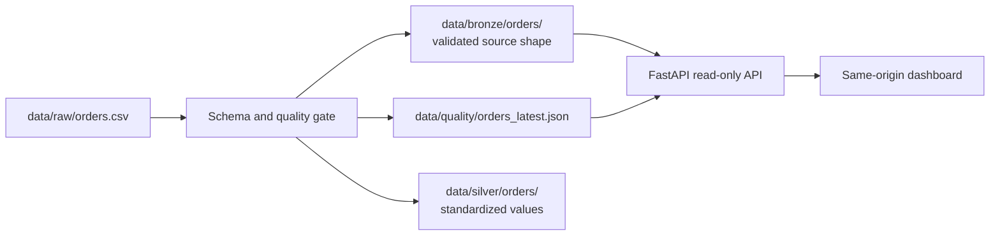

# E-Commerce Data Platform

An end-to-end e-commerce data platform focused on data engineering,
data pipelines, data quality, and automation.

## Quick start

The supported local runtime is Ubuntu 24.04 on WSL2 with Python 3.12 and Java 17. Run these steps from the repository root inside WSL. A native Windows Python environment is not the verified Spark runtime.

### 1. Get the project

```bash
git clone https://github.com/vanditagopal/ecommerce-data-platform.git
cd ecommerce-data-platform
```

If you already have a working copy, open that folder in WSL and continue from its root.

### 2. Install prerequisites and dependencies

```bash
sudo apt update
sudo apt install -y openjdk-17-jdk python3.12-venv
java -version
python3.12 --version
if [ ! -d .venv ]; then python3.12 -m venv .venv; fi
.venv/bin/python -m pip install -r requirements.txt
```

### 3. Prepare an input file

The pipeline reads `data/raw/orders.csv`. For a clean checkout, create it from the small checked-in example. `cp -n` preserves an existing input:

```bash
mkdir -p data/raw
cp -n docs/sample_orders.csv data/raw/orders.csv
```

### 4. Run the pipeline

```bash
.venv/bin/python src/pipelines/orders_pipeline.py
```

The pipeline overwrites its Bronze and Silver Parquet output directories and the latest quality report on each successful run. A failed validation writes a failure report but leaves existing Bronze and Silver datasets unchanged. Back up any outputs you need to preserve before rerunning against different input data.

### 5. Start the API and dashboard

In a second WSL terminal, from the repository root, run:

```bash
.venv/bin/python -m uvicorn src.api.app:app --host 127.0.0.1 --port 8000
```

Open <http://127.0.0.1:8000/> for the dashboard or <http://127.0.0.1:8000/docs> for the interactive API documentation. Leave this terminal running while using the app; press `Ctrl+C` to stop the server.

## Current capabilities

- Spark order pipeline with Bronze/Silver Parquet outputs and a machine-readable quality report.
- Fail-fast validation for missing fields, duplicate IDs, malformed dates, invalid statuses, and invalid amounts.
- Read-only FastAPI endpoints for health, summary metrics, quality reports, and paginated orders.
- Same-origin dashboard with current-page search/status filters, pagination, and loading/error/partial-data states.
- Unit/integration tests, deterministic Playwright E2E tests, and GitHub Actions CI.

The app runs locally and uses no AWS services. AWS is a possible future learning area, not part of the current runtime or deployment.

## Current pipeline architecture

The current implementation is intentionally minimal and local-first:

- Raw source files live under `data/raw/`.
- Generated sample datasets live under `data/generated/` and are not treated as production inputs.
- Bronze output is written to `data/bronze/orders/` after schema validation and quality checks pass.
- Silver output is written to `data/silver/orders/` after standardizing and normalizing fields such as order IDs, timestamps, status values, and monetary types.
- Quality reports are written to `data/quality/orders_latest.json`.



### Data lineage and output contract

`src/pipelines/orders_pipeline.py` follows a simple pipeline flow:

1. read raw CSV input from `data/raw/orders.csv`
2. validate required columns and data quality rules
3. write Bronze Parquet to `data/bronze/orders/`
4. transform the validated orders into standardized Silver values
5. write Silver Parquet to `data/silver/orders/`
6. persist a machine-readable quality report to `data/quality/orders_latest.json`

This is the current Bronze/Silver boundary for the project: Bronze preserves the validated source shape; Silver applies normalization and schema cleanup. The current API reads Bronze and the latest quality report. Gold is deferred until a concrete curated analytics use case exists.

## Backend API

Run the local API from the project root with the project environment:

```bash
.venv/bin/python -m uvicorn src.api.app:app --host 127.0.0.1 --port 8000
```

The current endpoints are:

- `GET /health` returns service liveness.
- `GET /api/v1/metrics/summary` returns input, accepted, rejected, reason, and Bronze row counts.
- `GET /api/v1/data-quality/latest` returns the latest quality report and whether rule counts may overlap.
- `GET /api/v1/orders?page=1&limit=20` returns stable `order_id`-ordered pagination over Bronze orders. `page` is 1..10,000; `limit` is 1..100. Response fields are `items`, `count`, `page`, `limit`, and `total`.
- `/docs` for the generated OpenAPI interface

The dashboard is served from the same origin at `/`. It reads the local pipeline outputs through the API and does not trigger pipeline runs. The orders endpoint accepts pages 1 through 10,000 and limits 1 through 100. Dashboard search and status filtering apply to the currently loaded page; the API does not yet provide server-side filtering. Response models are published through OpenAPI; missing or invalid quality and Bronze outputs return HTTP 503 with a `detail` field rather than appearing as valid empty data.

## Automated tests

Install the development tools and browser after completing the quick start:

```bash
.venv/bin/python -m pip install -r requirements-dev.txt
.venv/bin/python -m playwright install --with-deps chromium
```

Run the checks locally from the project root:

```bash
.venv/bin/ruff check src tests
.venv/bin/ruff format --check tests/e2e/test_dashboard.py tests/test_orders_api.py tests/test_orders_pipeline.py
PYTHONPATH="$PWD" .venv/bin/python -m unittest discover -s tests -v
.venv/bin/python -m pytest -m e2e tests/e2e -q
```

The browser tests run against deterministic in-memory API fixtures and an ephemeral local server; they do not overwrite or depend on the repository's data outputs. GitHub Actions runs these checks with Python 3.12, Java 17, and Chromium, and publishes the browser-test JUnit report as an artifact.

## Troubleshooting

- **`JAVA_GATEWAY_EXITED` or Spark cannot start:** confirm `java -version` reports Java 17 and run the project interpreter from WSL, not Windows Python. If Java is installed outside the current shell, reopen the WSL terminal so `JAVA_HOME` and `PATH` refresh.
- **Pipeline says the CSV is missing:** create `data/raw/orders.csv` from the example above, or place a source file with the documented columns at that path. The pipeline currently uses a fixed project-relative input path.
- **Dashboard shows unavailable data or the API returns 503:** run the pipeline successfully first, then restart/refresh the API dashboard. Check `data/quality/orders_latest.json` for validation failures.
- **Browser tests cannot launch Chromium:** run `.venv/bin/python -m playwright install --with-deps chromium` in WSL and retry the E2E command.
- **Port 8000 is already in use:** stop the other local server or choose another Uvicorn port, then open the matching localhost URL.

## Security and operating scope

The app is a local demo: Uvicorn binds to `127.0.0.1`, has no authentication, and should not be exposed to a network. Raw inputs and generated/parquet/report outputs remain local and are ignored by Git; inspect input data for personal or confidential information before using or sharing it. No cloud services, credentials, or paid runtime services are required. There is no deployment or exhaustive third-party license audit in this phase; perform a dependency/license and security review before redistribution or remote deployment.